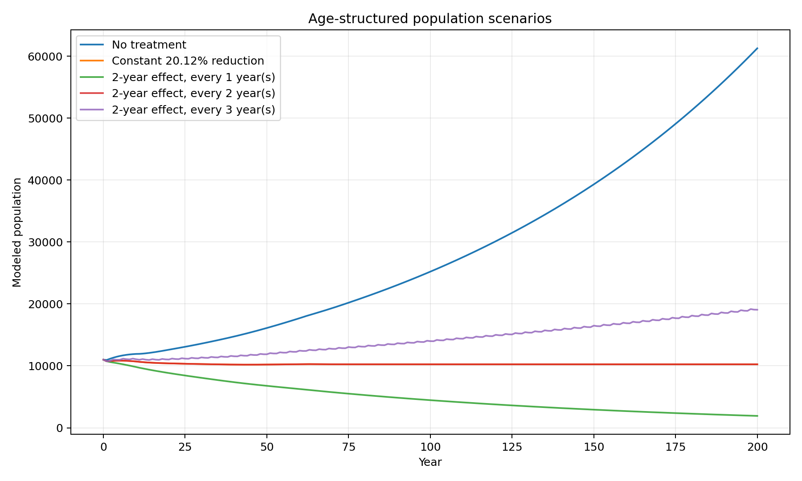

# Elephant Population Dynamics with a Leslie Matrix

An age-structured population model exploring how fertility-reduction schedules change
long-run elephant population dynamics. The project began as an undergraduate applied
mathematics study and has been rebuilt as a small, deterministic, tested Python package.



## What the model does

- Represents ages 0 through 70 with a 71 × 71 Leslie matrix.
- Uses age-specific fertility and survival assumptions to project annual populations.
- Computes the dominant eigenvalue as the long-run growth indicator.
- Finds the constant fertility reduction that makes the dominant eigenvalue equal to 1.
- Compares finite-duration interventions applied at different intervals.

Under the original implementation's assumptions, the untreated matrix has a dominant
eigenvalue of approximately `1.008918`. A fertility reduction of approximately
`20.12%` lowers it to `1.0`, the asymptotic equilibrium threshold.

## Modeling assumptions

The demonstration uses a 3.5-year birth interval, a 50% female-birth fraction, 75%
calf survival, 95% annual survival through most adult ages, and exponential survival
decay after age 60. Reproduction is indexed from ages 10 through 60 to reproduce the
original code's `20.12%` equilibrium result.

The annual female fertility is:

```text
(1 / 3.5) × 0.5 = 0.142857
```

This corrects a decimal-place typo in the original written report, whose matrix and
source code nevertheless used the correct value near `0.143`.

## Run the analysis

```bash
python -m pip install -r requirements.txt
python examples/run_analysis.py
python -m unittest discover -s tests -v
```

The example prints the key eigenvalue results and writes
`figures/scenario_comparison.png`. It uses a deterministic synthetic age distribution;
the source spreadsheet and course documents are intentionally not included.

## Reading the schedule experiment

Each intervention suppresses fertility for a chosen number of years. When active
cohorts overlap, their untreated shares multiply. With a two-year effect in this
specific model:

- yearly treatment compounds suppression and produces long-run decline;
- treatment every two years approximates the equilibrium case;
- treatment every three years introduces untreated gaps and produces growth with
  oscillation.

These are model-specific sensitivity results, not clinical guidance or a universal
conservation rule. Real decisions would require validated local demographic data,
individual-level treatment histories, health and welfare constraints, habitat capacity,
poaching and migration effects, environmental shocks, and adaptive monitoring.

## Repository structure

```text
src/                  reusable model and schedule simulation
examples/             end-to-end analysis and figure generation
tests/                regression and behavior tests
data/README.md        source provenance and data-exclusion policy
figures/              generated scenario comparison
```

## Privacy and publication note

Only reconstructed code, documentation, a synthetic example, and a generated figure
are published. Original Word reports, draft scripts, author metadata, screenshots, and
the source dataset are excluded.
